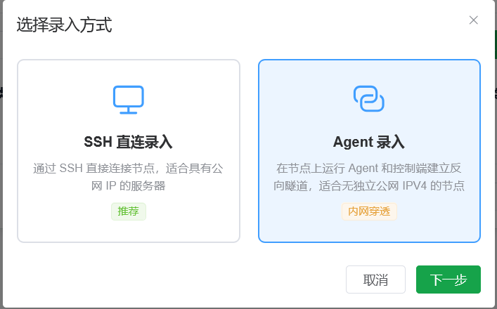
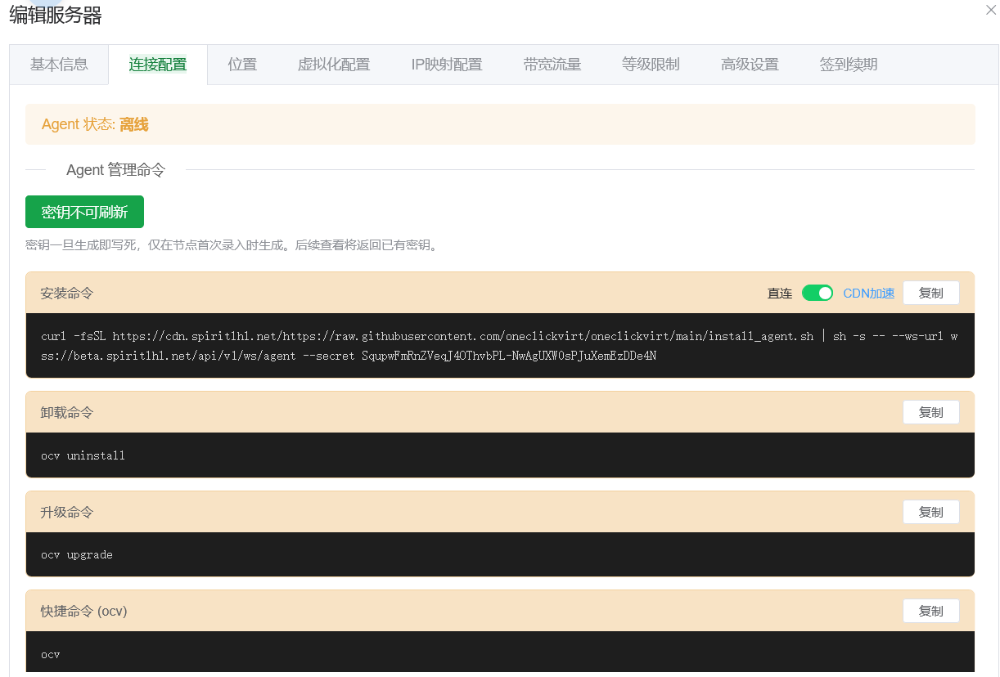
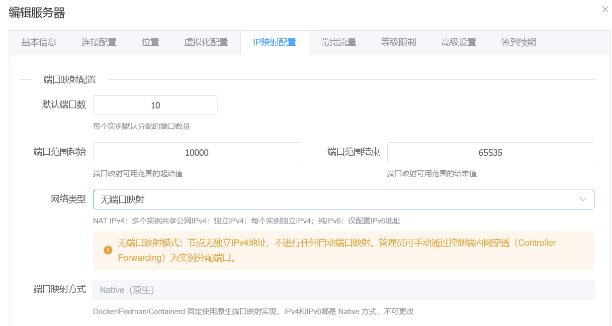
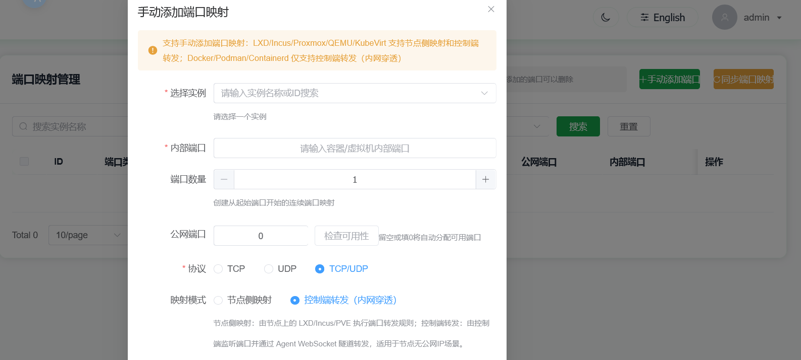
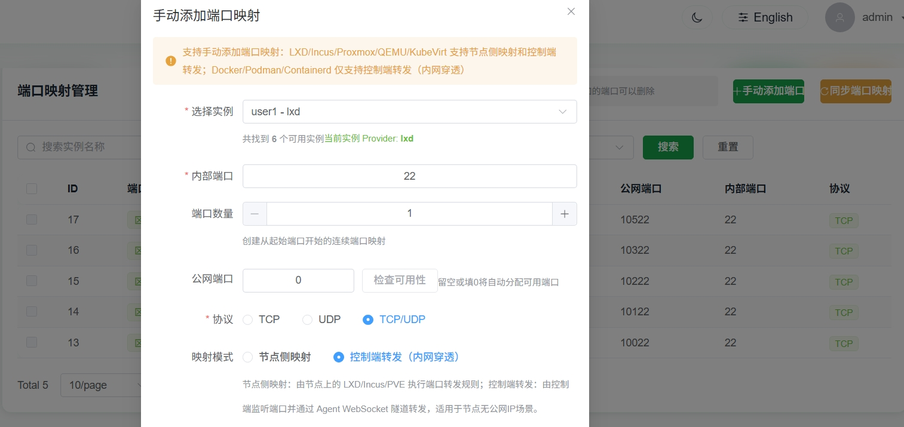
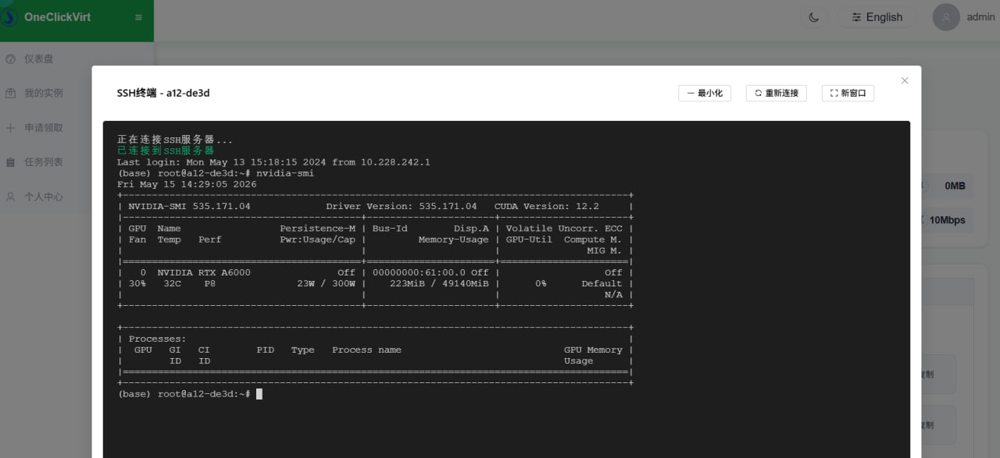

# Custom

## Manage a node with Agent mode

Agent mode is intended for home broadband, NAT, and private network nodes without a dedicated public IPv4 address.

1. Select **Agent mode** when adding the node.
2. Leave IP address and port empty for home, NAT, or private nodes. Fill them in for a node with a fixed public address.
3. Save the node and click **Generate install command** in Connection Configuration.
4. Run the command on the node server.
5. Return to the controller and click **Detect** to confirm that the node is online.




The node token is generated when the node is saved and cannot be changed separately. Keep it private. If it is exposed, delete the node and add it again.



After detection succeeds, node and container management uses the same steps as a standard node.


### Intranet port forwarding

For a local or NAT node:

1. Select **No port mapping** as the node network mode.
2. Open **Port Management** as an administrator and click **Add Port**.
3. Select **Controller Forwarding (Intranet Penetration)**.
4. Enter one TCP port per mapping. Optional fields can be left empty.

The controller must be a Linux server with a public IPv4 address, root access, and a script or bare-metal deployment. Docker, Docker Compose, and non-Linux controllers cannot provide this feature.





The reverse proxy must allow both WS and WSS. For HTTPS, configure the required certificate and ports first.

## Domain binding and reverse WebSocket

This workflow is for containers on Agent-mode nodes. The steps are the same for every supported container runtime.

1. Confirm that the node is online and that the container has a reachable IPv4 or IPv6 address and service port.
2. Point an `A` record to the node IPv4 address and an `AAAA` record to the node IPv6 address. A hostname may have both.
3. In **Domain Management**, select the instance, enter the domain, container address, and port, then save.
4. For HTTPS/WSS, upload a certificate and private key matching the domain and enable the HTTPS listener.
5. Test HTTP, HTTPS (when enabled), WS, and WSS separately.

HTTP and WS use the HTTP listener. HTTPS and WSS use the HTTPS listener. Enabling HTTPS alone does not open HTTP port 80. WebSocket clients use the root path of the bound domain.

### Cloudflare

- **DNS only**: point A/AAAA directly to the node and open the matching HTTP or HTTPS port.
- **Full / Full (strict)**: use an HTTPS origin on port 443. Full (strict) also requires a valid origin certificate. Enable WebSockets in Cloudflare for WSS.
- **Flexible**: the browser uses HTTPS while the origin uses HTTP. A container that forces HTTPS can create a redirect loop. Only enable **Trust Cloudflare HTTPS headers** on the node when the HTTP listener accepts traffic only from Cloudflare.

When Cloudflare **Always Use HTTPS** is enabled, the redirect happens at Cloudflare. DNS-only records do not use that rule. Do not configure Cloudflare and the container to force redirects in opposite directions.

<details>
<summary>Troubleshooting</summary>

1. Check the domain binding status and its error message.
2. Click **Sync Proxies** in the administrator page and try again; manual Nginx changes are not required.
3. Confirm that the Agent is online, the listener ports are open, and the container service is running.
4. After changing node settings, wait for the **Runtime Connection Reload** task to finish before checking again. Do not repeatedly save or restart.

Domain routes are restored after an Agent restart. If the problem remains, inspect the Agent service and listening ports:

```shell
systemctl status oneclickvirt-agent
ss -lntp
journalctl -u oneclickvirt-agent -e
```

</details>

### Security and upgrades

For a private controller address or a protected tunnel, configure HTTPS and prefer WSS.

After upgrading the controller, upgrade the node Agent as well. Confirm that no install or restart task is running before upgrading.

## Share a GPU with an LXD/Incus container

1. Install the GPU driver on the host and confirm that `nvidia-smi` works.
2. Follow the LXD/Incus setup guide, add the node with Agent mode, and pass the health check.
3. Create a GPU-enabled container from the redemption-code page.
4. Install the matching driver inside the container with `--no-kernel-module`.
5. Run `nvidia-smi` inside the container to verify the shared GPU.
6. To create more containers, stop this container and use it as the copy template.






See [Install a GPU driver inside a container](https://www.spiritysdx.top/20240513/#%E5%AE%B9%E5%99%A8%E5%86%85%E5%AE%89%E8%A3%85gpu%E9%A9%B1%E5%8A%A8) for a driver installation example.
