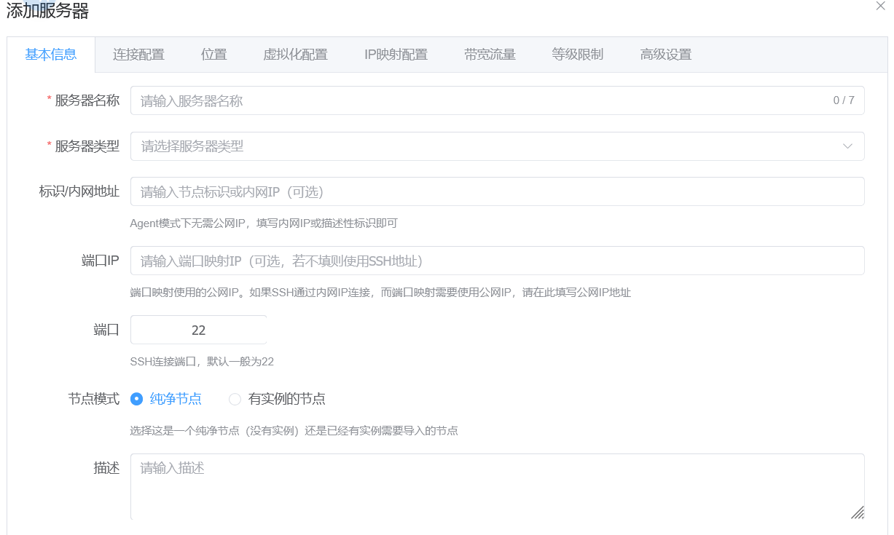
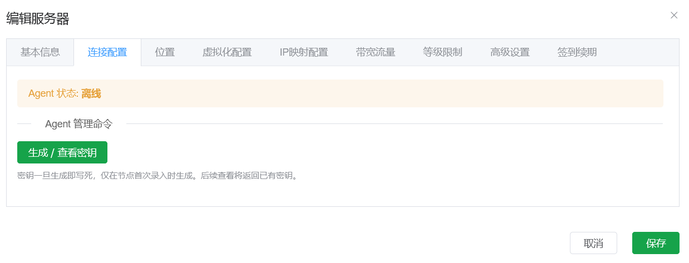
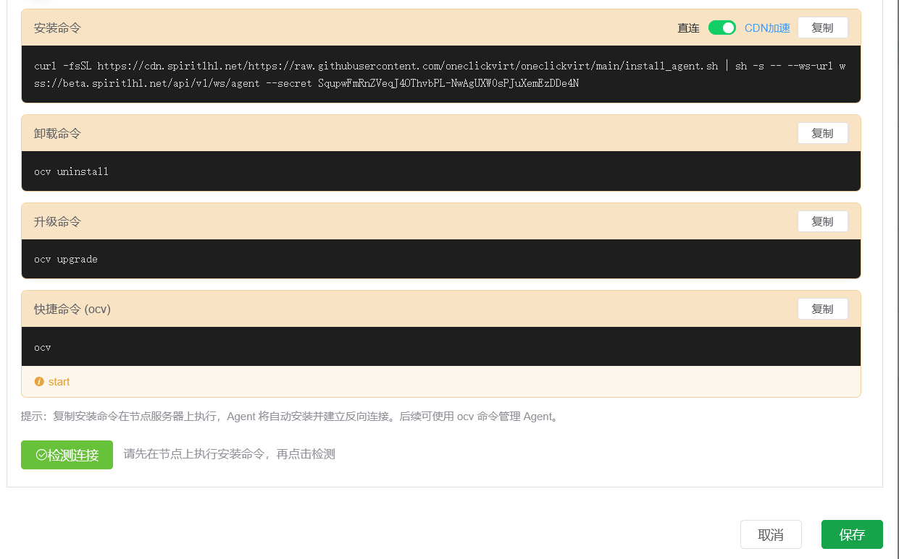
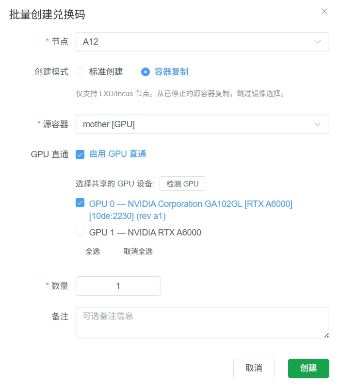

# 自定义

## 使用 Agent 模式纳管节点

Agent 模式适合家宽、内网或没有独立公网 IPv4 的节点。

1. 新增节点时选择 **Agent 模式**。
2. 家宽、NAT 或内网节点将 IP 地址和端口留空；有固定公网地址的节点可以照常填写。
3. 保存节点后，在“连接配置”中点击“生成安装命令”。
4. 将命令复制到节点服务器执行。
5. 回到主控页面点击“检测”，确认节点在线。






节点 Token 只在保存时生成，不能单独修改。请妥善保存；如果 Token 泄露，请删除节点后重新添加。


检测成功后，后续开设和管理步骤与普通节点相同。



### 内网穿透

本地或 NAT 节点按下面设置：

1. 节点网络模式选择 **无端口映射**。
2. 管理员进入“端口管理”，点击“添加端口”。
3. 映射方式选择 **控制端转发（内网穿透）**。
4. 每个映射填写一个 TCP 端口；其他可选项可以留空。

主控需要是有公网 IPv4 的 Linux 服务器，并使用脚本部署或裸机部署且具备 root 权限。Docker、Docker Compose 和非 Linux 主控不能提供此功能。


反向代理需要同时允许 WS 和 WSS。使用 HTTPS 时，主控和节点的证书、端口也要先配置好。

## 域名绑定和反向 WebSocket

适用于 Agent 模式节点上的容器。各容器运行时的操作步骤相同。

1. 先确认节点在线，并且容器有可访问的 IPv4 或 IPv6 地址和服务端口。
2. DNS 使用 `A` 记录指向节点 IPv4，使用 `AAAA` 记录指向节点 IPv6；同一域名可以同时配置两种记录。
3. 在“域名管理”中选择实例，填写域名、容器地址和端口后保存。
4. 需要 HTTPS/WSS 时上传匹配域名的证书和私钥，并启用 HTTPS 监听。
5. 保存后分别打开 HTTP、HTTPS（如启用）、WS 和 WSS 检查结果。

HTTP 和 WS 使用 HTTP 监听；HTTPS 和 WSS 使用 HTTPS 监听。只打开 HTTPS 不会自动打开 HTTP 80。WebSocket 客户端直接使用绑定域名的根路径即可。

### Cloudflare

- **仅 DNS**：A/AAAA 直接指向节点；节点必须开放对应的 HTTP 或 HTTPS 端口。
- **Full / Full (strict)**：建议回源 HTTPS 443；Full (strict) 还需要有效的源站证书；WSS 需要在 Cloudflare 开启 WebSockets。
- **Flexible**：浏览器使用 HTTPS、源站使用 HTTP。若容器强制 HTTPS，可能出现循环跳转；只有确定 HTTP 端口只接受 Cloudflare 回源时，才开启节点设置中的“信任 Cloudflare HTTPS 标头”。

Cloudflare 开启“始终使用 HTTPS”时，跳转由 Cloudflare 完成；“仅 DNS”记录不会经过这条规则。不要让 Cloudflare 和容器同时设置相反的强制跳转。

<details>
<summary>连接失败时怎么查</summary>

1. 先查看域名绑定的状态和错误提示。
2. 在管理员页面点击“同步代理”再试一次，不需要手动修改 Nginx。
3. 确认节点 Agent 在线、监听端口已放行、容器服务仍在运行。
4. 如果刚修改节点设置，等待“运行时连接刷新”任务结束后再检查；不要连续重复保存或重启。

节点重启后域名路由会自动恢复。仍失败时再查看 Agent 服务日志和监听端口：

```shell
systemctl status oneclickvirt-agent
ss -lntp
journalctl -u oneclickvirt-agent -e
```

</details>

### 安全和升级

需要隐藏主控地址或保护隧道时，给主控配置 HTTPS，并优先使用 WSS。

主控升级后，请同时升级节点 Agent。升级前先确认当前节点没有正在执行的安装或重启任务。

## 使用 LXD/Incus 共享 GPU

1. 在宿主机安装显卡驱动，并确认 `nvidia-smi` 能正常运行。
2. 按 LXD/Incus 教程完成环境安装，再用 Agent 模式纳管并通过健康检查。
3. 在兑换码页面创建带 GPU 的容器。
4. 进入容器安装与宿主机匹配的驱动，安装时加 `--no-kernel-module`。
5. 在容器内运行 `nvidia-smi` 验证共享成功。
6. 需要批量创建时，停止并保留这个容器，将它作为复制模板。




驱动安装示例见：[容器内安装 GPU 驱动](https://www.spiritysdx.top/20240513/#%E5%AE%B9%E5%99%A8%E5%86%85%E5%AE%89%E8%A3%85gpu%E9%A9%B1%E5%8A%A8)。
