# 使用说明

这里将详细说明本面板的使用方式，如有问题请加群求助管理员：https://t.me/oneclickvirt

## 切换语言

如果面板打开后是中文，点击初始化、登录或面板页面右上角的 **English** 就能切换。这样只会更改当前浏览器的显示语言。


要让新访客默认看到英文，管理员可进入 **系统配置 → 其他配置**，将 **系统默认语言** 设为 **English**，再点击 **保存当前配置**。

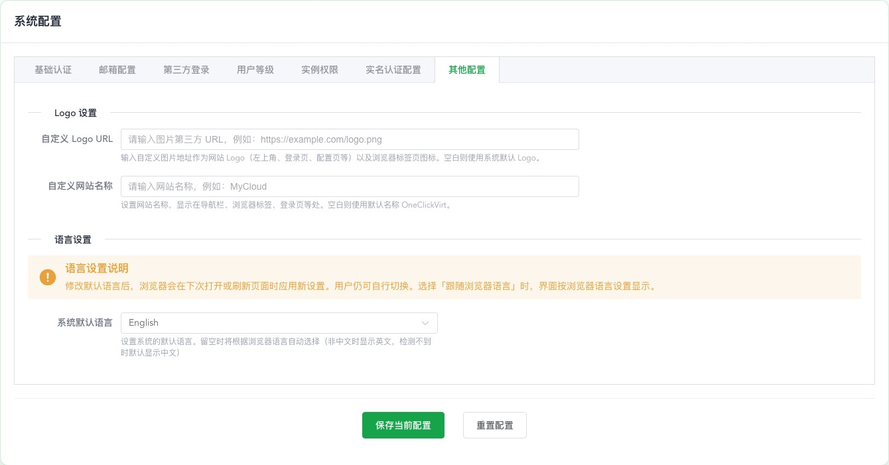

默认语言更改后，已经访问过面板的浏览器也会在下次打开或刷新时切换。之后仍可以从右上角切换回自己习惯的语言。

## 用户管理

登录管理员界面后，打开 **用户管理**。如果初始化时已经自己设了强密码，可以跳过重置。需要换密码时，找到对应账户，点击 **重置密码** 并确认。


重置密码会自动生成强密码，仅展示一次，务必复制保存好，避免遗忘。

如果需要更改用户类型，点击对应账户的 **编辑**，修改 **用户类型** 后保存。

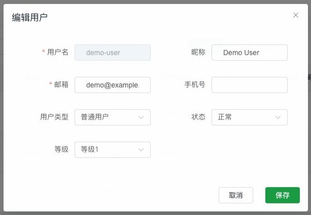

管理员可以点击右上角头像，下拉栏目中有切换管理员和普通用户视图的按钮，如果需要测试任何功能，可以直接使用管理员用户测试。(普通用户没有这个视图切换按钮)


## 纳管节点

首先，请确保要纳管的节点已经安装了至少一种受支持的虚拟化技术。

请在部署面板的机器上先 ping 节点 IP，建议延迟在 300ms 以内且丢包率较低，否则可能出现连接不稳定，进而导致控制命令执行失败或遗漏。

在 **节点管理** 点击 **添加服务器**，选择 **SSH 直连录入**，再点击 **下一步**。下面先填必填项，可选项按需调整。使用 Agent 的节点见 [Agent 录入](./oneclickvirt_custom.md#使用-agent-模式纳管节点)。

### 基本信息(必填)

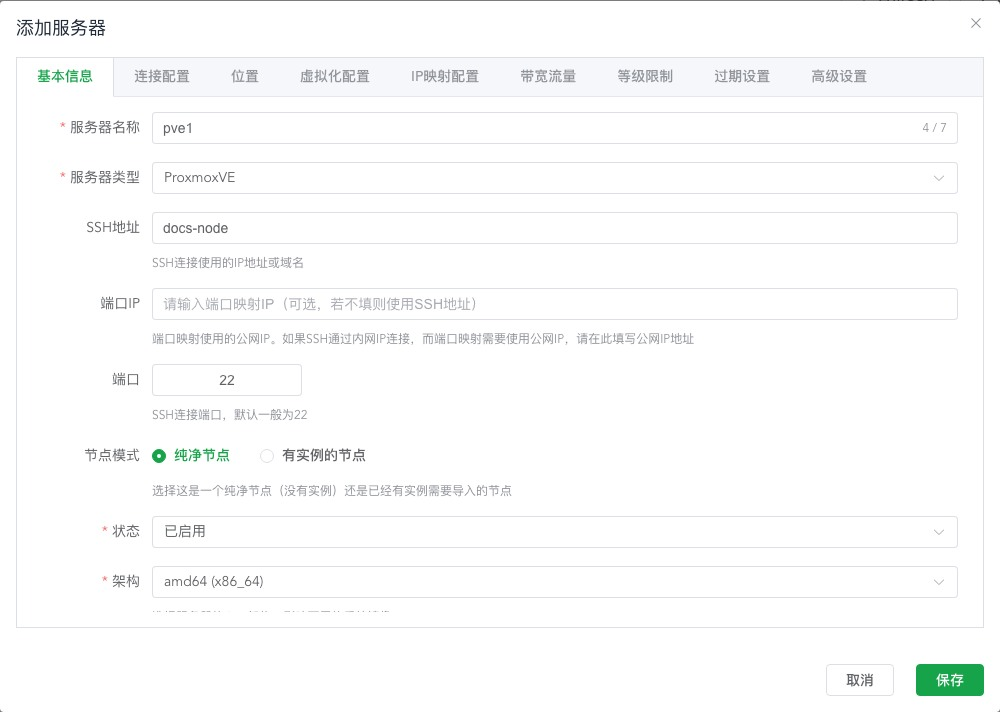

服务器名称最好仅英文+数字，不要用特殊字符，最好控制在6个字符以内，后续开设容器或虚拟机的时候，会自动带上这个服务器名称前缀。

服务器类型选择你实际安装了的虚拟化技术名称，docker默认只能开设容器，其他虚拟化技术可开设虚拟机。

SSH地址填写节点的公网IPV4地址或内网SSH链接地址，这个地址将被用作SSH连接和API连接。

NAT端口映射优先使用端口IP进行映射，如果不提供具体的端口IP，将使用SSH地址的IP进行映射，都不需要是公网IPV4地址。

端口框填写SSH连接节点的端口。

空节点选 **纯净节点**。已有实例就选 **有实例的节点**，需要直接纳管时再打开 **自动导入实例**。可指定导入后的所有者，留空则归当前管理员。保存后可以在任务列表看进度，Agent 节点会等 Agent 上线后再开始检索。

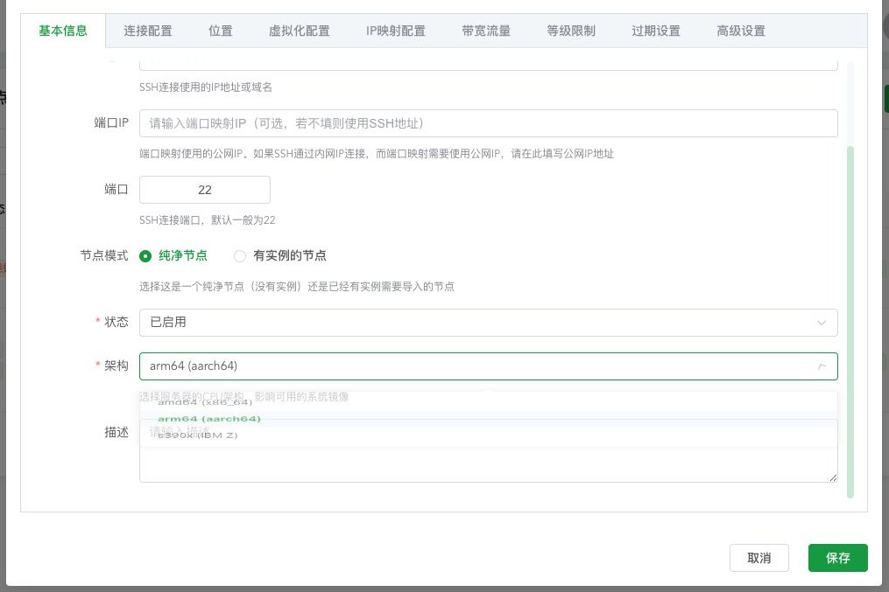

描述可备注当前节点的一些信息，仅管理员可见。

状态默认为启用状态，允许后面的健康检测后，被普通用户申请领取开设实例。

架构是节点本身的架构，目前支持纳管amd64架构和arm64架构的节点，自己对应选取。

### 连接配置(必填)

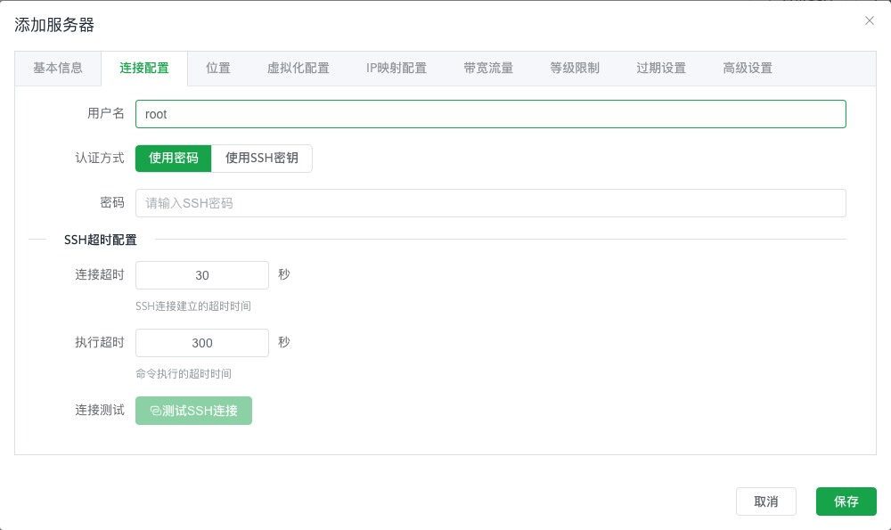

用户名推荐使用 root。后续自动配置 API 时需要安装依赖，非 root 用户可能会遇到权限问题。

密码就是SSH登录用的密码，当然如果你不使用密码，使用密钥登录也是可以的。

SSH超时配置是设计测试连通性和优化容错率的，也可以用来检测连通性。

前面信息填完后，点击 **测试SSH连接**。测试成功后会显示推荐超时，想用这个值就点击 **应用推荐值**。

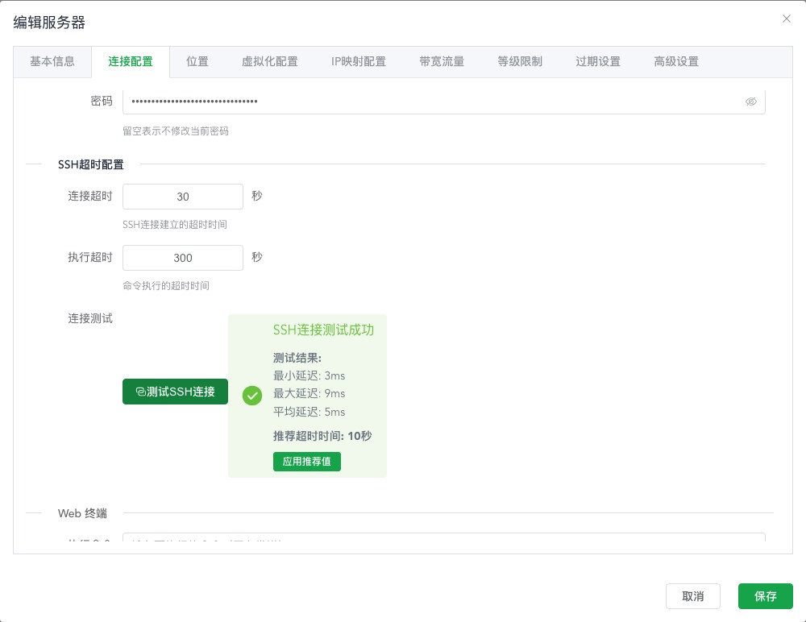

这里显示的延迟不是纯 ICMP ping，而是实际在节点上执行命令的往返耗时，因此在 2 秒左右甚至更高都可能是正常现象。

这么设计是为了适配一些与面板机器连通性极差的节点，这些参数的数值增加意味着更高的容错率。

执行超时时间一般不需要进行修改，除非你的节点本身性能特别弱，执行命令耗时很久。

### 位置信息(可选)

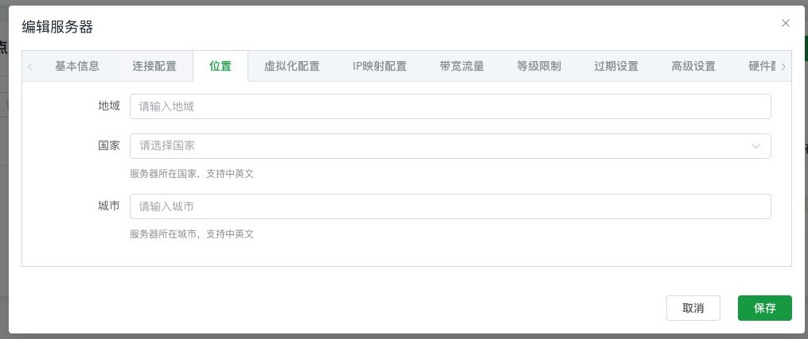

直接输入具体国家进行点击勾选，大部分国家都已经有预设了，有对应的旗帜图标。

设置位置后，普通用户的申请领取界面将可以看到对应的旗帜和地区，还有自动匹配的所在大洲。

可选填对应的城市，不填写也行，不影响使用。

### 实例类型和数量限制(必填)

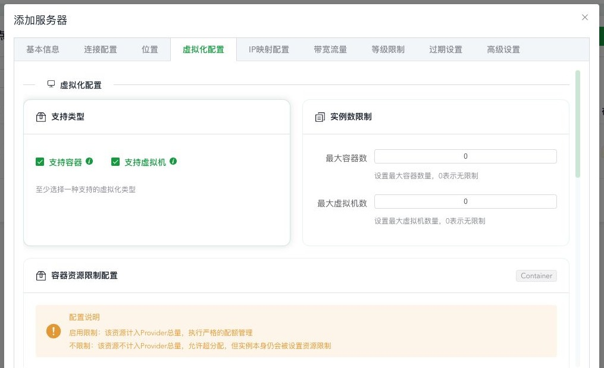

对于docker类型的节点，只能开设容器，其他虚拟化类型都支持开设容器和虚拟机(前提是节点本身支持，不支持的强行开设任务会自动失败)。

如果不需要开设虚拟机，务必取消虚拟机的勾选。

数量限制如果保持默认的参数0，意味着不进行节点层面的这个类型的实例数量限制。

对于容器类型，建议按照以下公式设置数量

节点空闲存储盘大小 / 将分发的实例的最小硬盘大小 = 实例最大数量

对于虚拟机类型，则

节点空闲内存大小(含虚拟内存) / 将分发的实例的最小内存大小 = 实例数量

这样计算的原因在于，容器一般不限制总的CPU数量和内存大小，但限制硬盘大小，虚拟机一般内存才是开设数量的瓶颈。

如果你需要超开，那么以上计算规则得到的数值可适当增大，并配置下面的配置。

### 资源超配置(可选)

超配置资源含义是是否要进行对应资源的严格限制，取消限制意味着不进行检查强行开设，可能导致开设任务失败。

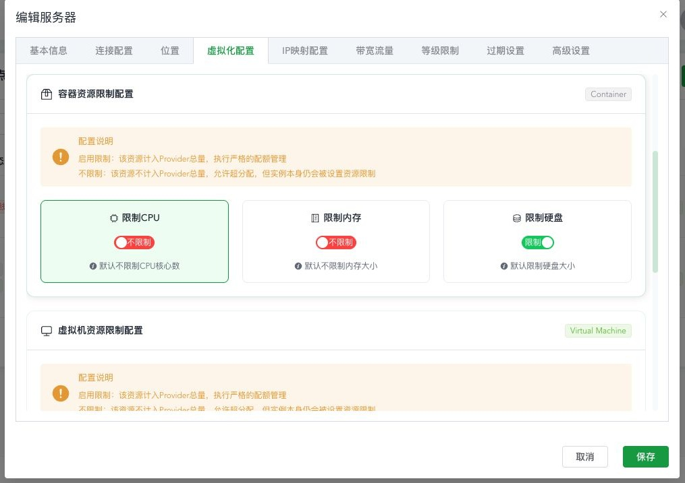

默认容器类型不限制CPU和内存预分配的总量，但限制预分配的硬盘总量，以达到最优化的资源共享和最大化的实例数量，一般不需要进行修改。

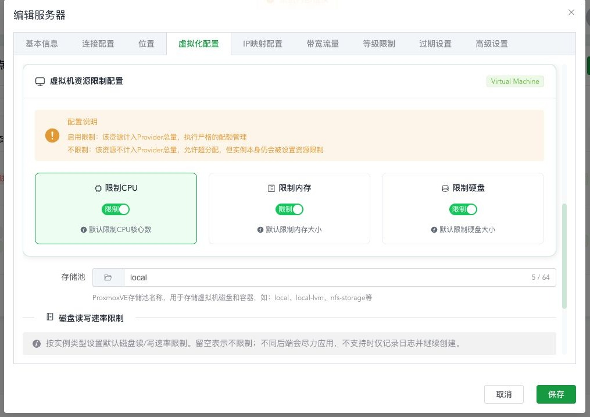

默认虚拟机类型限制所有资源，预分配的资源总量最大值不超过实际资源大小。

对于ProxmoxVE，还有一个开设的硬盘所在存储池名字可以设置，如果是多盘的pve，需要设置开设在哪个存储池上。

其他类型的虚拟化环境在安装过程中有询问具体存储池开设位置了，所以就不需要设置了。

总的来说，如果需要限制哪种资源不被超开，那么就点击限制，限制后将无法超开对应资源，不限制则可超开对应资源。

这里限制的是该节点上此类实例的总资源占用，用于计算可用资源和限制实例创建。

不推荐进行修改，除非你知道这块的设置在干什么。

### IP映射配置(可选)

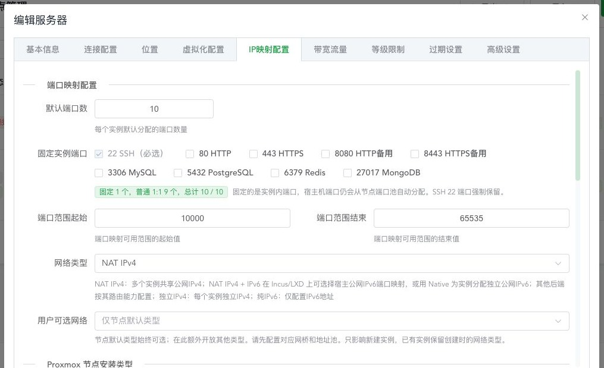

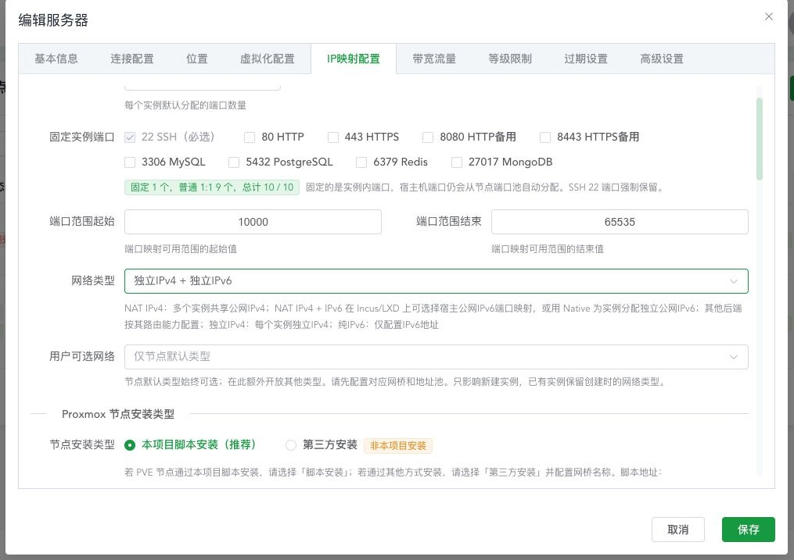

一般不需要进行修改，这里可以设置每个实例的端口映射数量、区间、网络配置方式、端口映射方式。

默认开设带NAT映射公网IPV4端口的实例，映射的IP的优先级是：端口IP > SSH连接时的IP(如果端口IP未设置时使用)

如果节点本身有一段IPV6子网大于等于/80大小的，那么选择网络配置更改，可开设带公网独立IPV6地址的实例。

极端一点，也可以开设仅独立IPV6地址的实例，自行选择吧。

不推荐对映射方式进行修改，除非你知道这块的设置在干什么，默认的配置已经是最好的配置了。

### 地址池录入

选好支持静态地址分配的网络类型并保存节点，再编辑该节点，打开 **IP映射配置**。单个地址、CIDR 和 `起始 IP - 结束 IP` 都可以填，每行一项，同一地址池可混用这三种写法。

```text
192.168.1.1 - 192.168.1.100
2001:db8::1 - 2001:db8::100
```

范围包含首尾，每个范围最多 4096 个地址。重复项会自动跳过。IPv6 单次录入展开后最多 5000 项，大 CIDR 会保存为前缀并按需分配。使用 Incus/LXD 的托管 NAT IPv6 时，地址由节点网络分配，独立公网地址方式见 [网络常见问题](./oneclickvirt_qa.md)。

IPv4 填在 **IPv4地址池** 下，填完点击 **添加到池**。

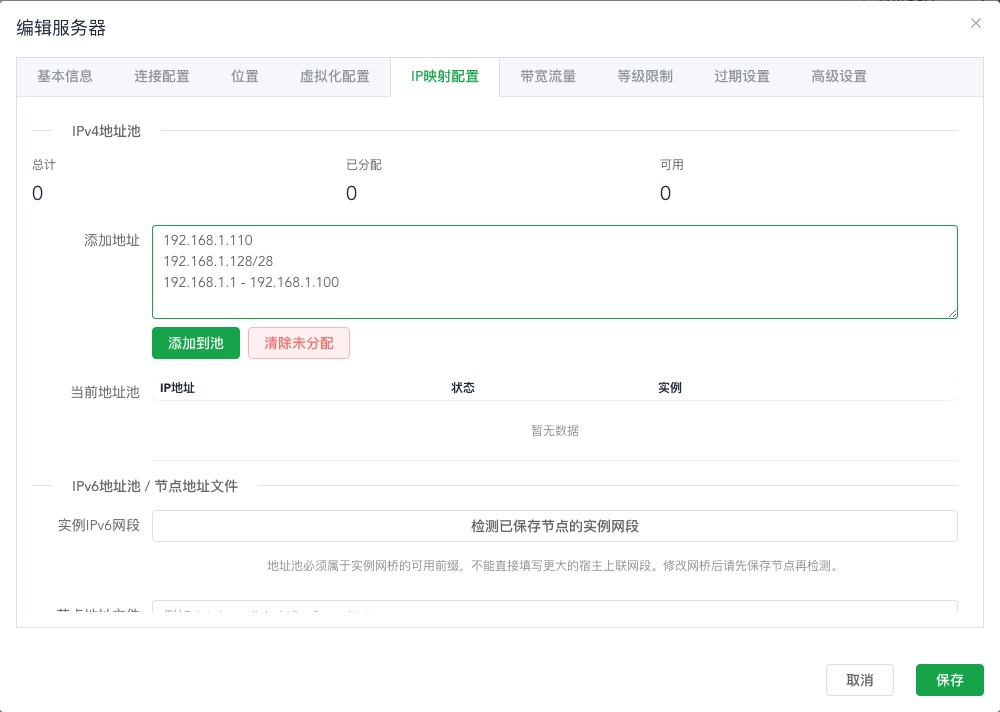

IPv6 填在 **IPv6地址池 / 节点地址文件** 下的 **地址或网段**，填完点击 **保存地址**。Proxmox VE 的地址池要落在实例网桥的子网内，可用同一栏的检测按钮查看子网。

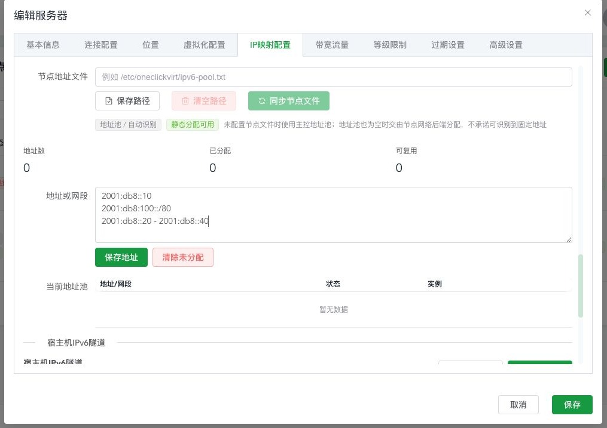

### 带宽流量配置(必填)

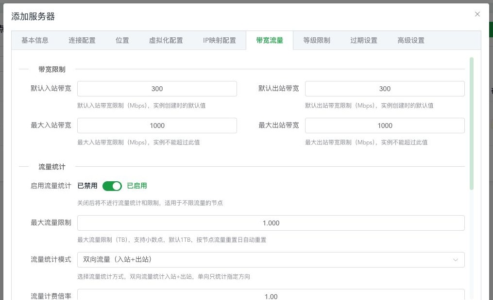

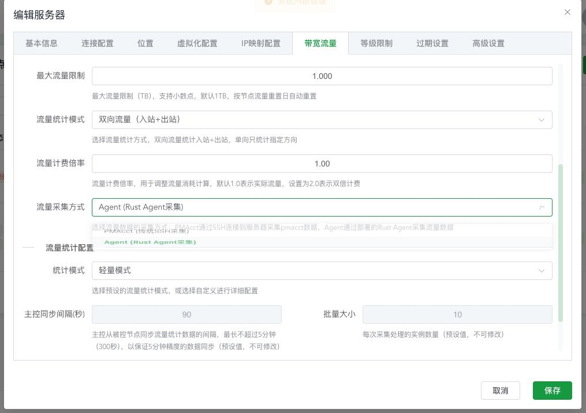

字面意思，设置节点开设出的实例的最大带宽和可用流量总量，默认不自动启用流量监控和流量统计。流量周期默认跟随自然月在每月 1 日重置，也可以在后面的过期设置中指定每月几号重置；如果选择 29、30、31 号，短月份会自动按当月最后一天处理。

#### agent(推荐)

先在 **带宽流量** 中启用流量统计，将 **流量采集方式** 设为 **Agent**。保存节点后，打开 **操作 → 监控管理 → Agent 监控（推荐）**，点击 **部署 Agent**。

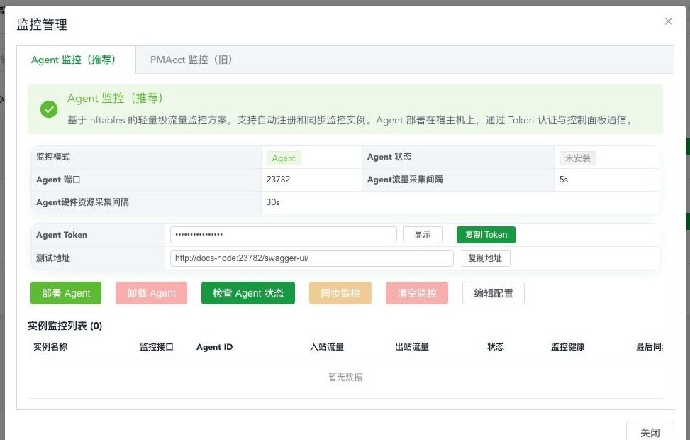

部署完成后点击 **检查 Agent 状态**。

这个方法适合支持 nftables 或 iptables 的 Linux 节点，默认用 nftables。要改用 iptables 或排除部分 IP 的流量，在弹窗里点击 **编辑配置**，保存后点击 **同步监控**。

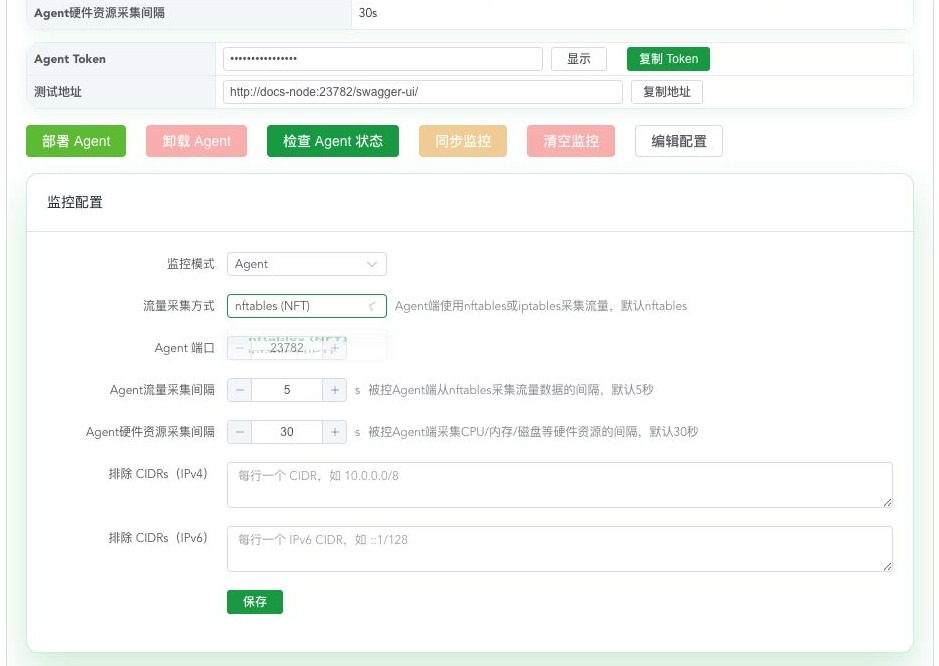

一般不需要进行自定义配置，默认的配置已经足够日常使用了。

#### pmacct(不推荐)

PMAcct 是旧版采集方式，一般只有仍在使用 PMAcct 的节点才需要看这部分。新节点优先用上面的 Agent。

启动pmacct的流量监控会有对应的内存负担，因为需要缓存流量统计数据，哪怕本项目极致优化后，还是会随着带宽的增大而增大，内存不够用的不要开启流量统计。

启用了流量统计的话，要注意统计模式，默认的统计模式是最普适的，如果你本地的性能足够好(主要是内存够多)，可选择更高的采集频率和采集数量，如果性能非常差，建议选择最后一档。当然也支持自定义参数，但不推荐新手修改，预设的模式足矣。

如果启用了流量统计，那么需要注意等级分配的带宽不要过大，监控将动态按照分配的带宽进行配置文件生成进行监控，带宽越大监控占用的内存越大。

| 级别 | 实例带宽 | `plugin_pipe_size` | `sql_cache_entries` | 基础占用 | 突发占用 |
|---:|:---:|:---:|:---:|:---:|:---|
| 低 | ≤50 Mbps | 2 MB | 32 | 5~8 MB | 8~12 MB |
| 中低 | 51~100 Mbps | 10 MB | 64 | 10~15 MB | 15~30 MB |
| 中 | 101~200 Mbps | 25 MB | 128 | 15~20 MB | 30~50 MB |
| 中高 | 201~500 Mbps | 50 MB | 256 | 20~30 MB | 50~80 MB |
| 高 | 501~1000 Mbps | 128 MB | 512 | 30~50 MB | 80~150 MB |
| 超高 | 1001~2000 Mbps | 256 MB | 768 | 50~80 MB | 150~300 MB |
| 极高 | >2000 Mbps | 512 MB | 1024 | 80~120 MB | 300~600 MB |

流量统计的误差10G大概会偏差0.1G左右，已自动处理NAT映射以及带IPV6独立IP的情况，无需手动管理了。

如需停止旧版采集，在节点的 **操作 → 监控管理 → PMAcct 监控（旧）** 中先点击 **删除流量监控**，再关闭节点的流量统计。已有监控可通过 **检测流量监控** 检查。

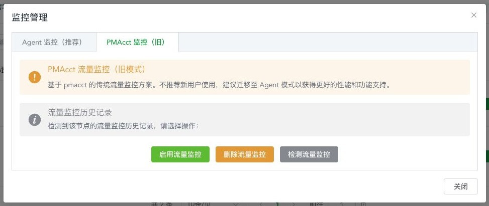

流量重置日会影响当前周期统计、用户/实例/节点三级超限判断，以及因流量超限被自动停止的实例恢复排队。到达节点的重置日后，系统会先清理该节点的流量超限标记，再重新计算用户和实例层级限制，仍然未超限且没有其他冻结原因的实例会自动创建启动任务。

### 等级限制(必填)

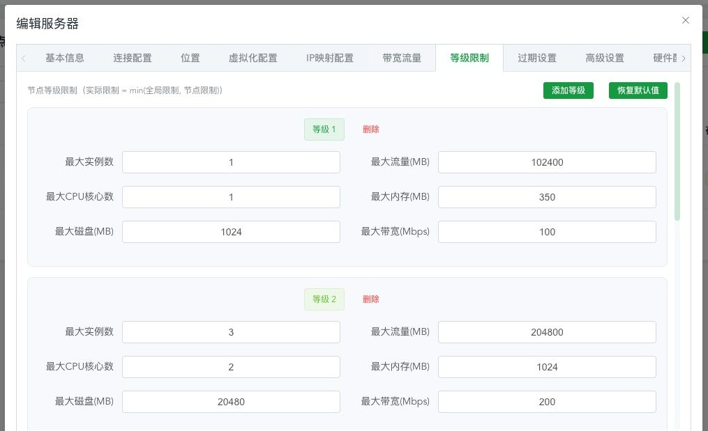

这块预设了5个等级，用户申请领取的时候，将经过这个限制筛选配置。

在实际实例开设过程中，节点层面的等级限制 将与 全局的用户等级的资源限制 互相比对，取其中的最小值作为用户在当前节点可用的资源限制。

这样设置是为了特殊化当前节点对应等级的用户可开设的实例的配置限制，避免有时候全局限制不适用当前节点，全局限制在系统配置中可设置，一般用于用户整个账户层面的使用资源限制。

### 过期设置(可选)

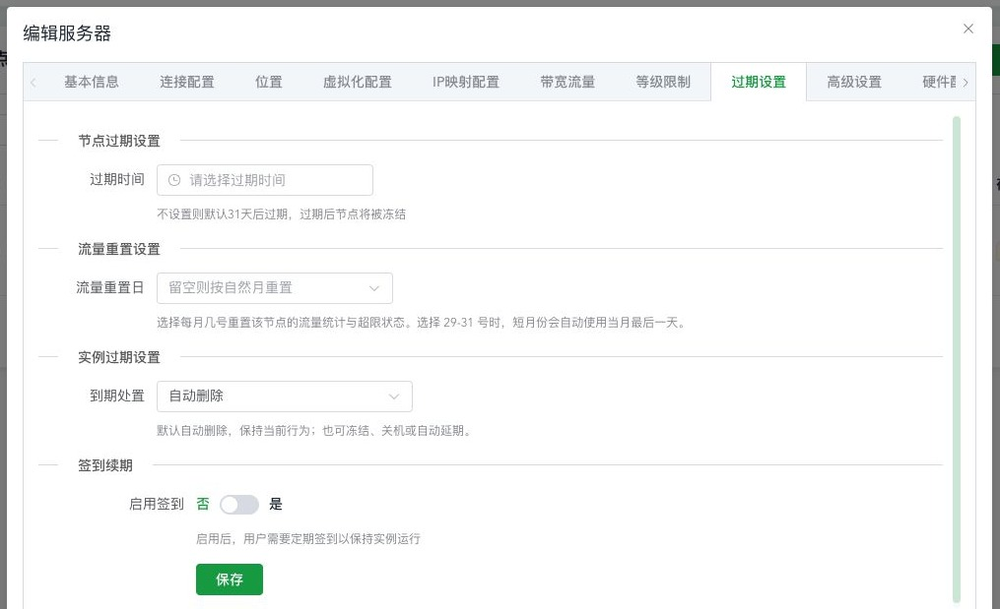

过期时间：

防止用户继续操作已经过期的节点，过期节点将自动冻结，此时对应的实例将不允许任何操作，但不会自动删除，如果冻结了节点请及时清理删除节点。

流量重置日：

留空时默认跟随自然月，每月 1 日自动进入新的流量周期。也可以设置为每月 1 到 31 号中的任意一天，系统会按照每个节点单独计算当前周期、下次重置时间和超限实例自动恢复逻辑。

实例到期处置：

实例到期后可以按节点配置冻结、停止、自动延长或等待清理。因为过期被自动停止的实例，在用户签到续期后会自动创建启动任务，不需要管理员手动补发。

签到续期：

原签到续期分页已合并到过期设置中，这里统一配置是否开启签到、签到奖励天数、连续签到奖励和相关限制。用户签到成功并延长过期时间后，系统会同步解除因过期造成的冻结；如果实例此前是因为过期被自动停止，会自动进入启动排队。

### 高级设置(可选)

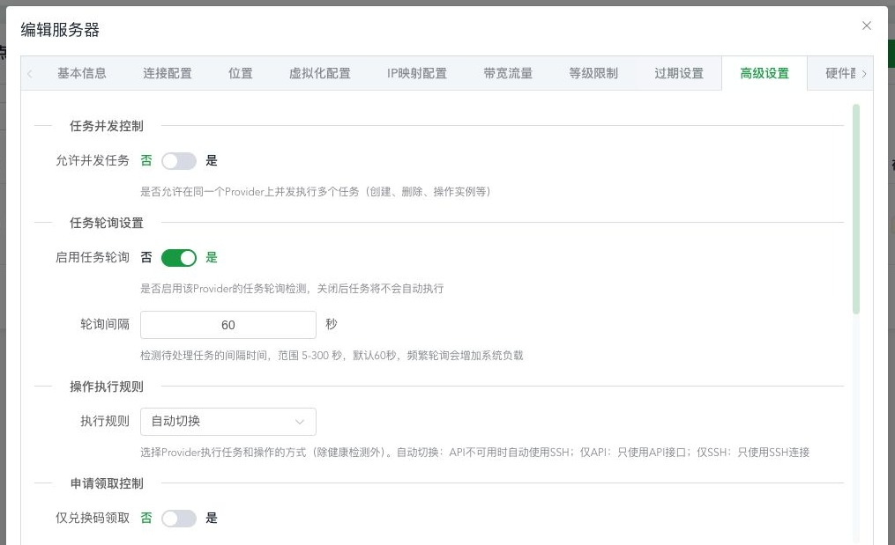

任务并发控制：

默认单线程串联执行，同一时刻，只会存在一个增删改的任务(对应实例的开设删除重置操作)。

可以更改为多线程并发执行，同一时刻可以存在多个增删改任务，只有并发执行时，并发数量的设置才有意义。

串联执行适合节点本身性能弱或平台用户数量少的情况，并发操作适合节点本身性能强或用户数量多的情况，请自行选择模式。

个人推荐使用默认设置，并发执行可能存在未完全测试出来的边界条件，可能有BUG。

任务轮询设置：

控制是否启用任务执行，以及任务执行轮询检查状态的间隔，一般保持默认即可。

操作执行规则：

节点操作模式支持 仅API，仅SSH，自动切换 ，默认使用自动切换模式，一般来说没必要修改，除非有特殊需求。

Proxmox VE、LXD 和 Incus 节点保存后，可打开 **操作 → 配置API** 并点击 **执行配置**。在配置历史中可查看任务进度和日志。配置完成后再运行 **健康检查**，确认 API 已在线。

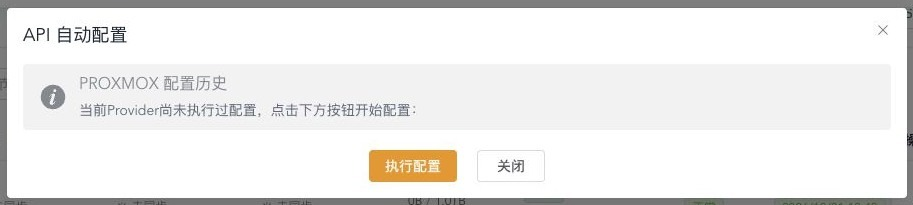

申请领取控制：

普通用户默认可以自己选系统和等级内的配置。开启 **仅兑换码领取** 后，先到 **兑换码管理** 点击 **批量创建**，选好节点、系统和规格。等实例开好后，再把对应的兑换码发给用户。

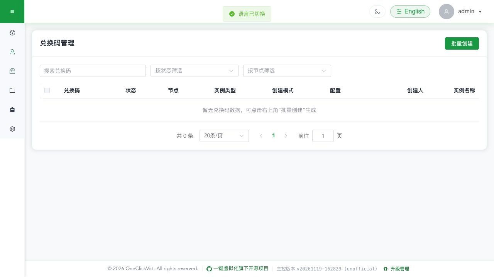

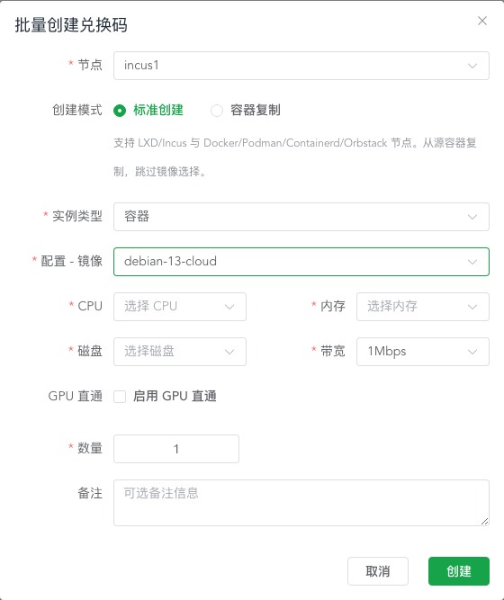

硬件监控：

如果要启用本功能，那么后续在监控管理处必须启用agent监控，不部署对于的agent监控，将无法使用硬件监控。硬件监控的相关采集参数可自定义间隔，在监控管理的配置编辑分页有相关的参数设置。

[Agent 监控设置](#agent-推荐)

默认将监控实例的CPU、内存、硬盘的24小时内的使用情况，仅保留24小时的数据。

### 硬件配置(可选)

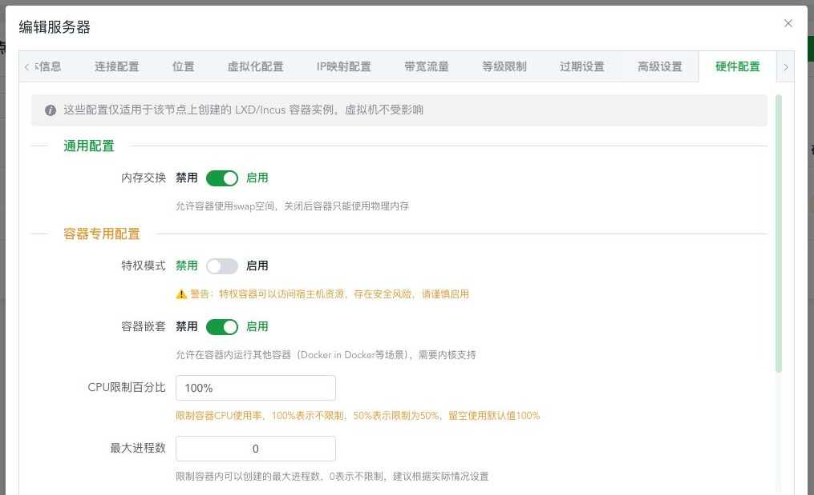

仅lxd和incus下支持设置默认的实例参数配置，一般使用默认的就行了，除非你需要手动限制某些特殊的硬件资源，否则一般不需要修改。

如果你需要设置CPU占用的最大百分比等内容，这里的设置可以满足你的需求。

### 健康检测(必选)

在节点列表的对应行点击 **操作 → 健康检查**。

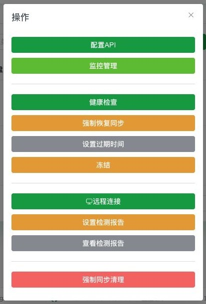

SSH 节点完成健康检查并同步资源后，如果已开放申请领取，普通用户就可以在申请页面看到它。Agent 节点会在上线后上报资源。

健康检测后会显示对应的类型的连接状态是否在线，会自动检测整机的实际资源总量，这个资源总量就是前面设置的不超配开设的资源总量限制。

使用 SSH 或自动切换模式时，是否配置 API 按需选择。

## 实例管理

### 备注别名

管理员和实例所属用户都可以在列表或详情里点击名称旁的编辑按钮。备注最多 128 个字符，清空后显示原名。搜索时用实例原名，宿主机上的实例标识、开关机、重装和 SSH 连接方式照旧。接口参数可在主控的 `/swagger/index.html` 查看。

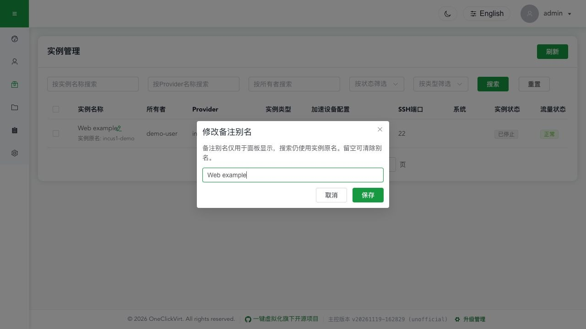

### SSH 文件传输

打开实例的 SSH 连接，点击 **文件传输**，进入要操作的目录即可上传或下载。上传中断时，重新选同一个文件，就可以按提示续传或重传。同名文件会在上传完成后替换。

## 系统镜像

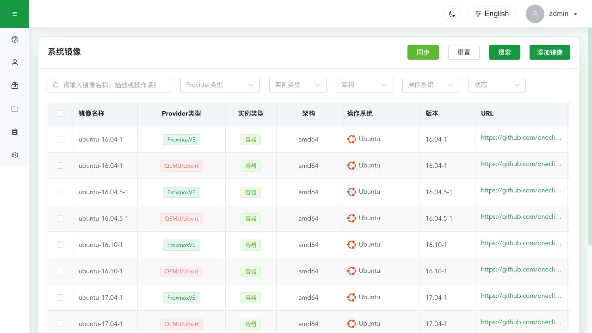

默认种子数据会录入所有虚拟化环境可用的镜像，默认仅启用alpine和debian镜像，避免用户可用镜像过多。

如果需要任何系统任何虚拟化环境任何架构对应的镜像，请自行搜索后进行启用，否则用户选择不了对应的镜像。

需要用自己的镜像时，点击 **添加镜像**，选好 Provider 类型、实例类型、架构和操作系统，再填写能直接下载的镜像地址。

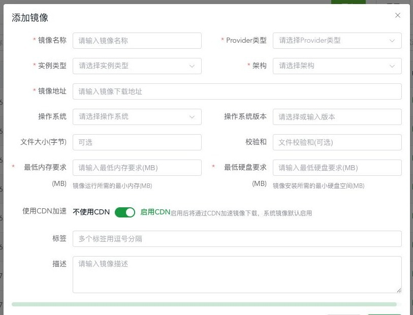

## 端口管理

管理员可在“资源 > 端口管理”中查看和维护控制端数据库记录的端口映射。手动添加映射时，节点侧映射由对应虚拟化节点写入转发规则；控制端转发适用于节点没有公网入口的内网穿透场景，目前每条记录只支持一个 TCP 端口。

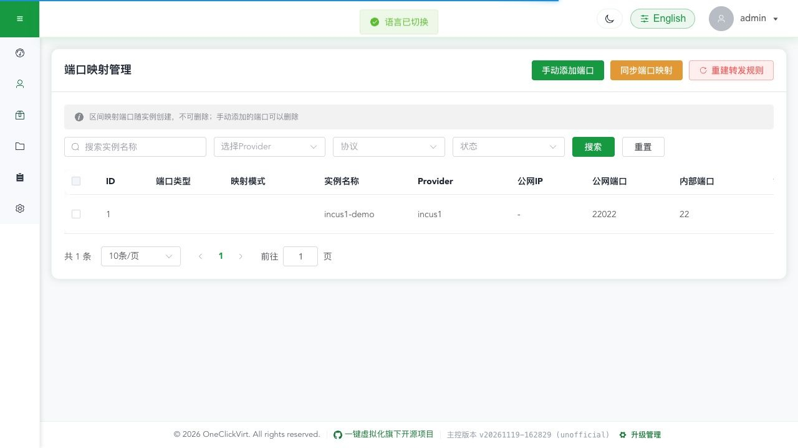

“同步端口映射”用于预览并清理实例已不存在等情况下遗留的数据库记录。“重建转发规则”执行相反方向的修复：以控制端数据库为准，将选中的记录重新应用到节点或控制端。重建前会列出可修复、需重启和被跳过的记录；执行时需要先确认风险，再完整输入 `REBUILD` 进行二次确认。

展开跳过的记录可以查看原因。下图的节点离线，端口映射会被跳过。

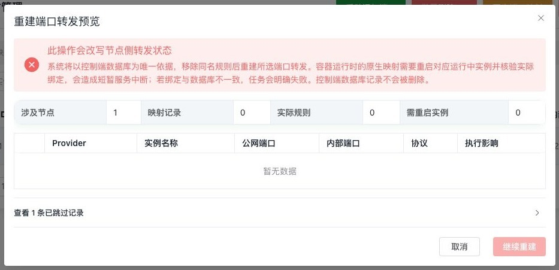

容器运行时的原生端口绑定需要重启对应的运行中实例，期间会有短暂中断。任务会在重启后核验实际绑定，未按数据库记录生效时会明确标记失败。该操作不会删除控制端数据库中的端口映射记录。

## 系统配置

一般的选项这里不多赘述了，有必要特殊说明的就两个配置。

### 用户等级配置(必填)

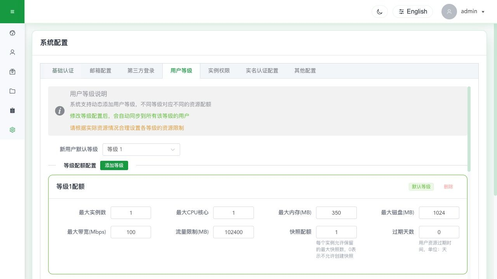

这里限制的是普通用户等级对应的总的账户可用的资源总量。

在对应节点开设实例的时候，这个全局配置将和节点本身的等级配置共同筛选同时符合条件的配置提供给用户选择。

### 实例权限配置(必填)

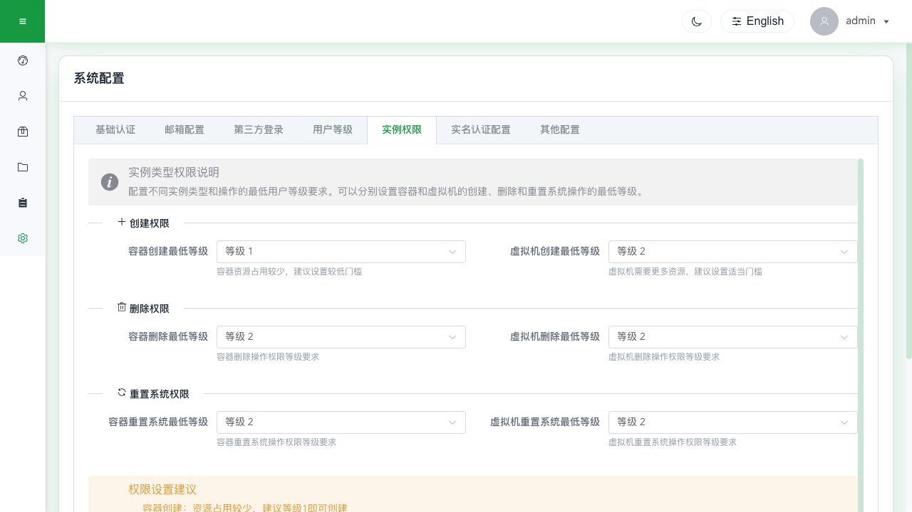

这里可用控制用户敏感操作所需的最低等级，可以控制 实例创建、实例删除、实例重置系统 所需的最低用户等级。

## 配置文件

默认的系统配置已经足够轻度使用了，如果需要高级自定义则需要修改配置文件，或初始化后在管理员界面进行修改。默认数据库不可用时以配置文件为权威配置来源，数据库可用时将以数据库中的配置为权威配置来源。简单的说，初始化后相关配置修改不建议再修改系统配置文件，建议只在浏览器上通过管理员面板修改配置。

https://github.com/oneclickvirt/oneclickvirt/blob/main/server/config.yaml

这里是完整的初始化的配置文件，下面将讲解具体的配置项目：

### auth 认证配置

```yaml
auth:
    email-password: ""
    email-smtp-host: ""
    email-smtp-port: "3306"
    email-username: root
    enable-email: false
    enable-oauth2: false
    enable-public-registration: false
    enable-qq: false
    enable-telegram: false
    qq-app-id: ""
    qq-app-key: ""
    telegram-bot-token: ""
    frontend-url: ""
```

认证模块的配置项,用于控制用户登录注册的方式和第三方登录集成。

- `email-password`: 邮件服务的认证密码,用于SMTP发送邮件时的身份验证
- `email-smtp-host`: SMTP服务器地址,如 `smtp.gmail.com`
- `email-smtp-port`: SMTP服务器端口,常用端口为 `25`、`465`(SSL)、`587`(TLS)
- `email-username`: SMTP服务器登录用户名,通常是完整的邮箱地址
- `enable-email`: 是否启用邮箱登录功能
- `enable-oauth2`: 是否启用OAuth2第三方登录功能
- `enable-public-registration`: 是否允许公开注册,关闭后仅管理员可创建账号
- `enable-qq`: 是否启用QQ登录
- `enable-telegram`: 是否启用Telegram登录
- `qq-app-id`: QQ互联平台申请的App ID
- `qq-app-key`: QQ互联平台申请的App Key
- `telegram-bot-token`: Telegram Bot的API Token
- `frontend-url`: 前端访问地址,需要包含协议头(`http://`或`https://`),结尾斜杠可选。OAuth2回调地址依赖此配置

### captcha 验证码配置

```yaml
captcha:
    enabled: true
    expire-time: 300
    height: 40
    length: 4
    width: 120
```

图形验证码的生成和验证配置,用于前端登录注册页面的安全验证。

- `enabled`: 是否启用验证码功能
- `expire-time`: 验证码过期时间,单位为秒
- `height`: 验证码图片高度,单位为像素
- `length`: 验证码字符长度
- `width`: 验证码图片宽度,单位为像素

### cdn 内容分发网络配置

```yaml
cdn:
    base-endpoint: https://cdn.spiritlhl.net/
    endpoints:
        - https://cdn0.spiritlhl.top/
        - http://cdn3.spiritlhl.net/
        - http://cdn1.spiritlhl.net/
        - http://cdn2.spiritlhl.net/
```

系统镜像下载时使用的CDN加速节点配置。

- `base-endpoint`: 主CDN节点地址,优先使用
- `endpoints`: 备用CDN节点列表,按顺序进行重试。系统会自动选择可用节点进行镜像下载

一般情况下不需要修改此配置,预载的系统镜像都托管在本组织仓库中,默认CDN节点已能提供良好的下载加速。

### mysql 数据库配置

```yaml
mysql:
    auto-create: true
    config: charset=utf8mb4&parseTime=True&loc=Local
    db-name: oneclickvirt
    engine: InnoDB
    log-mode: error
    log-zap: false
    max-idle-conns: 10
    max-lifetime: 3600
    max-open-conns: 100
    password: ""
    path: ""
    port: ""
    prefix: ""
    singular: false
    username: root
```

MySQL数据库连接和行为配置。初始化判断逻辑:当`path`和`port`都为空时,系统认为需要进行初始化,此时必须确保目标数据库为空数据库。

- `auto-create`: 是否自动创建数据库(如果不存在)
- `config`: 数据库连接参数,包括字符集、时间解析等
- `db-name`: 数据库名称
- `engine`: 数据库存储引擎,推荐使用InnoDB
- `log-mode`: 数据库日志模式,可选值为`silent`、`error`、`warn`、`info`
- `log-zap`: 是否使用zap日志库记录数据库日志
- `max-idle-conns`: 最大空闲连接数
- `max-lifetime`: 连接最大生命周期,单位为秒
- `max-open-conns`: 最大打开连接数
- `password`: 数据库密码
- `path`: 数据库服务器地址
- `port`: 数据库服务器端口
- `prefix`: 数据表名前缀
- `singular`: 是否使用单数表名(默认为复数)
- `username`: 数据库用户名

### quota 配额限制配置

```yaml
quota:
    default-level: 1
    level-limits:
        "1":
            max-instances: 1
            max-resources:
                bandwidth: 100
                cpu: 1
                disk: 1025
                memory: 350
            max-traffic: 102400
        "2":
            max-instances: 3
            max-resources:
                bandwidth: 200
                cpu: 2
                disk: 20480
                memory: 1024
            max-traffic: 204800
        "3":
            max-instances: 5
            max-resources:
                bandwidth: 500
                cpu: 4
                disk: 40960
                memory: 2048
            max-traffic: 307200
        "4":
            max-instances: 10
            max-resources:
                bandwidth: 1000
                cpu: 8
                disk: 81920
                memory: 4096
            max-traffic: 409600
        "5":
            max-instances: 20
            max-resources:
                bandwidth: 2000
                cpu: 16
                disk: 163840
                memory: 8192
            max-traffic: 512000
```

用户等级和资源配额的控制配置。内存、硬盘、流量的默认单位均为MB。

#### 全局配置

- `default-level`: 新注册用户的默认等级

#### instance-type-permissions 实例类型权限

控制不同等级用户可以执行的操作类型。

- `min-level-for-container`: 创建容器实例所需的最低用户等级
- `min-level-for-delete`: 在普通用户端执行删除操作所需的最低等级
- `min-level-for-vm`: 创建虚拟机实例所需的最低用户等级

#### level-limits 等级配额限制

定义每个用户等级对应的资源配额上限,键为等级数字。

每个等级包含以下配置:

- `max-instances`: 该等级用户可创建的最大实例数量
- `max-resources`: 单个实例的最大资源限制
  - `bandwidth`: 最大带宽,单位为Mbps
  - `cpu`: 最大CPU核心数
  - `disk`: 最大硬盘空间,单位为MB
  - `memory`: 最大内存,单位为MB
- `max-traffic`: 该等级用户的最大总流量,单位为MB

### zap 日志配置

```yaml
zap:
    compress-logs: true
    director: storage/logs
    encode-level: LowercaseLevelEncoder
    format: console
    level: info
    log-in-console: false
    max-array-elements: 5
    max-backups: 15
    max-file-size: 5
    max-log-length: 2000
    max-string-length: 1000
    prefix: '[oneclickvirt]'
    retention-day: 3
    show-line: false
    stacktrace-key: stacktrace
```

系统日志记录的详细配置,基于zap日志库。

- `compress-logs`: 是否压缩归档的日志文件
- `director`: 日志文件存储目录
- `encode-level`: 日志级别编码方式,可选`LowercaseLevelEncoder`(小写)、`CapitalLevelEncoder`(大写)
- `format`: 日志输出格式,可选`console`(控制台格式)、`json`(JSON格式)
- `level`: 日志级别,可选`debug`、`info`、`warn`、`error`。开发调试时建议使用`debug`,生产环境使用`info`或`warn`
- `log-in-console`: 是否同时输出日志到控制台
- `max-array-elements`: 数组类型字段最大记录元素数
- `max-backups`: 保留的历史日志文件最大数量
- `max-file-size`: 单个日志文件最大大小,单位为MB
- `max-log-length`: 单条日志最大长度,超出部分会被截断
- `max-string-length`: 字符串字段最大记录长度
- `prefix`: 日志前缀标识
- `retention-day`: 日志文件保留天数,过期自动删除
- `show-line`: 是否显示日志调用的文件名和行号
- `stacktrace-key`: 堆栈跟踪信息的键名

注意:调试问题时应将`level`设置为`debug`以获取详细日志信息。
